# Screenshots

Taken in headless tetra sessions at 1280×720 by [make.sh](make.sh), one
script per picture in [scenes/](scenes/). Run `docs/screenshots/make.sh`
to take them again (`-p asan` or a scene name, e.g. `make.sh launcher`).

## Desktop

The terminal and the system monitor snapped side by side (Super+Left,
Super+Right), apps pinned to F-key slots in the task bar.

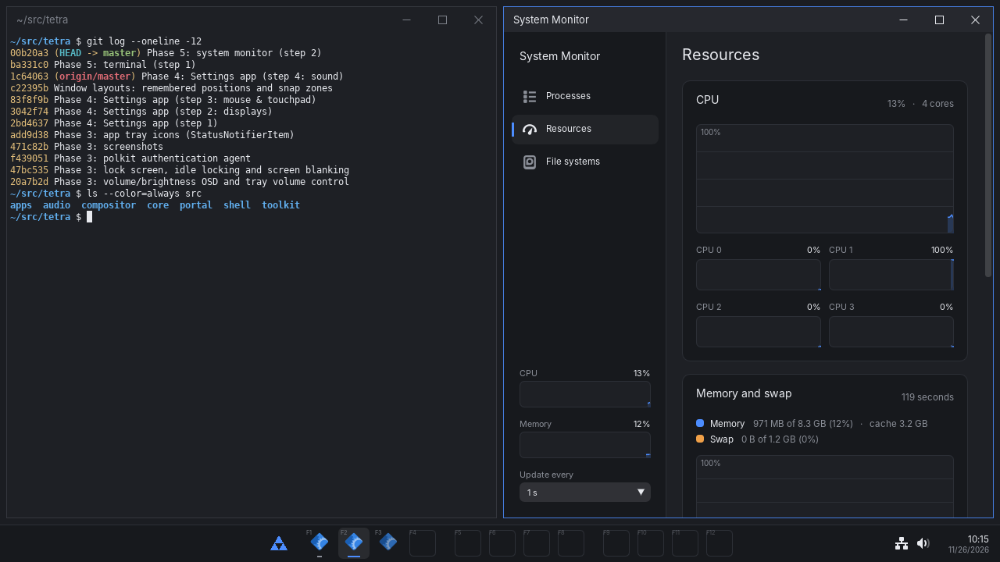

## Launcher

Super opens it; typing filters the installed apps, Enter starts one.

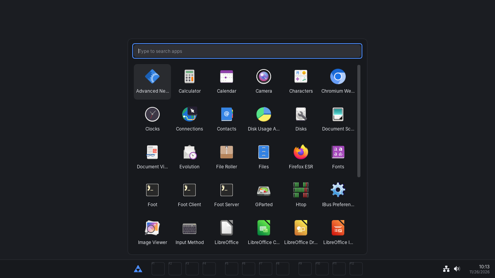

## Snap zones

Dragging a window with Shift held shows the display's zone layout (here
"priority"); letting go snaps the window into the highlighted zone.

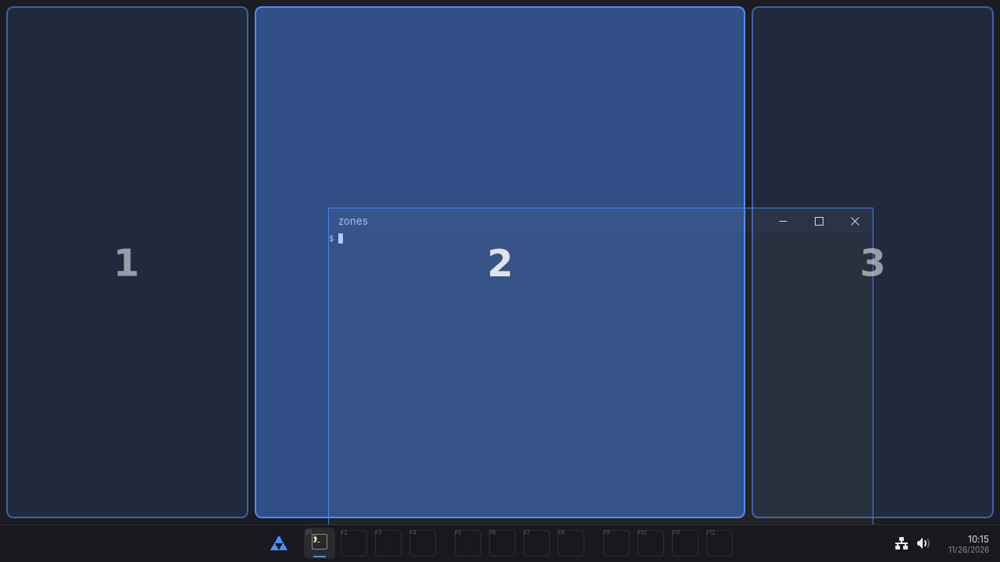

## Notifications and OSD

Notifications with icons, actions and urgency, served by tetra-shell; the
volume OSD from the volume keys.

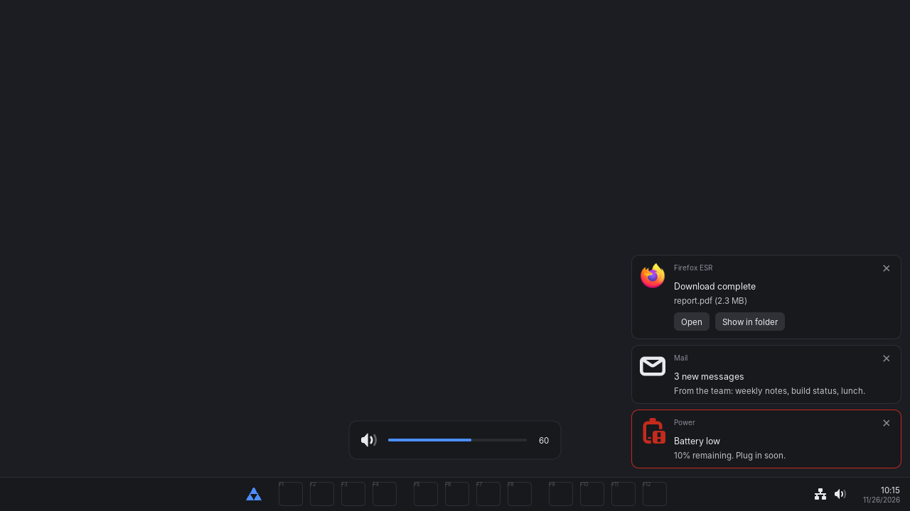

## Settings

Super+I. An editor for `~/.config/tetra/config.json` that changes only the
values you change and keeps your comments.

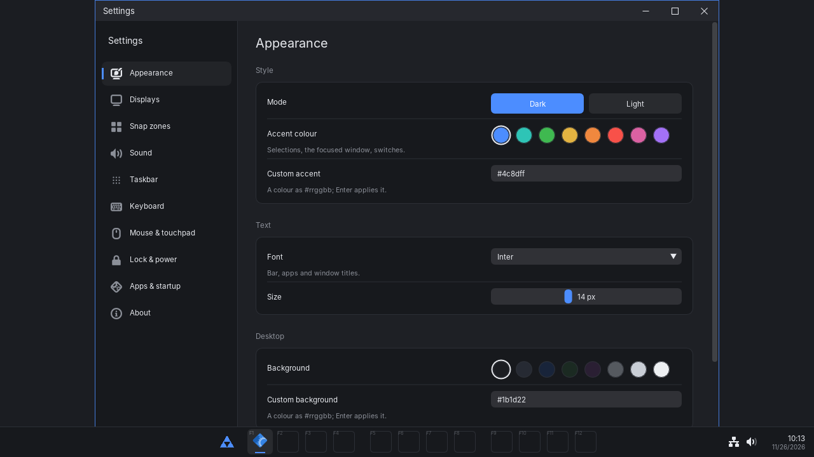

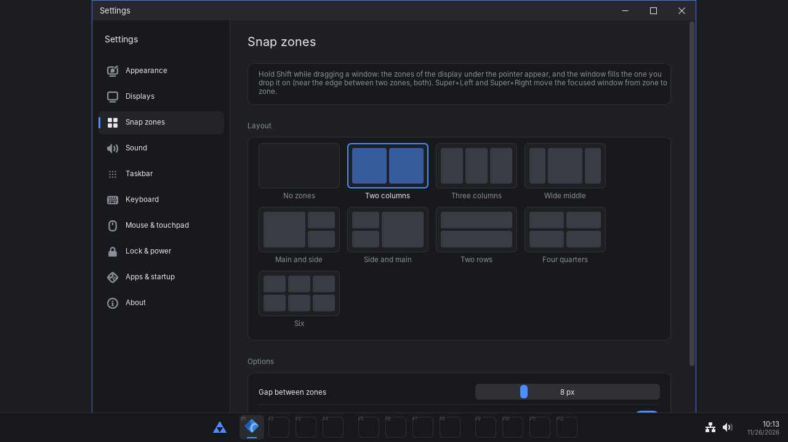

## Light theme

`theme.dark: false` with an orange accent, applied live to the bar, the
window decorations and every tetra app.

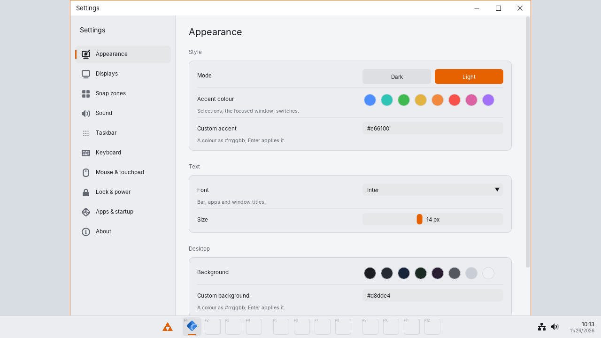

## Terminal

tetra-terminal (Super+Return): libvterm, 256 and true colour, text
attributes, box drawing that joins, Unicode.

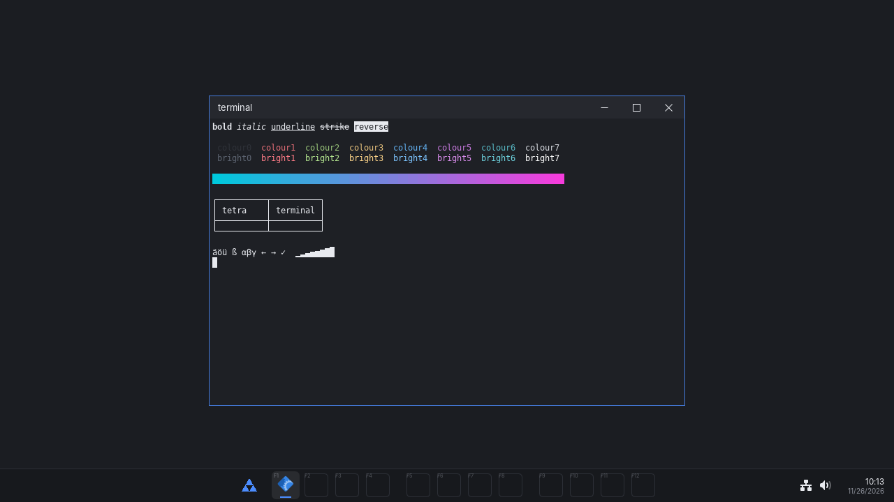

## System monitor

Ctrl+Shift+Escape: processes, resources and file systems.

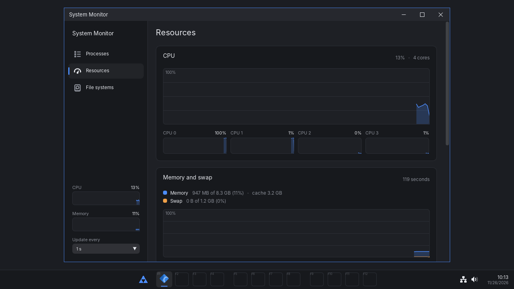

## File chooser

What GTK, Qt and Firefox show when they open or save files (tetra-portal,
through xdg-desktop-portal).

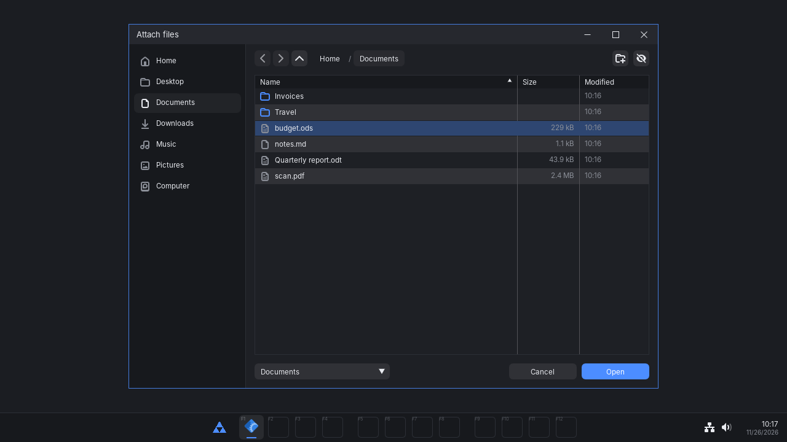

## Region screenshot

Shift+Print or Super+Shift+S: drag a rectangle on a frozen, dimmed copy
of the screen.

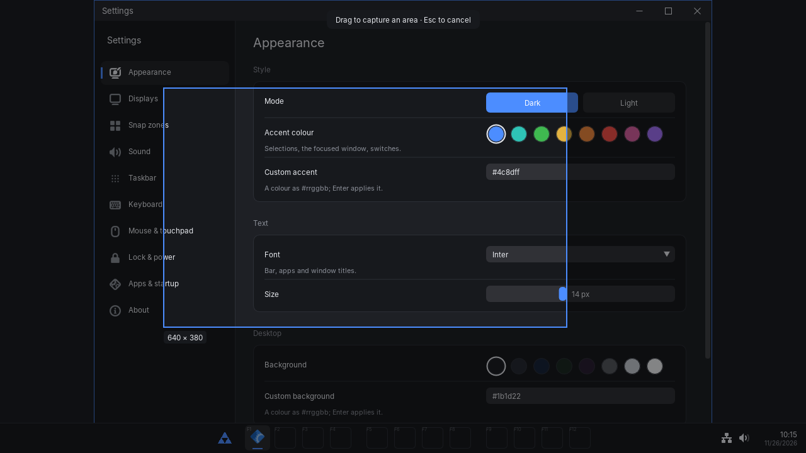
